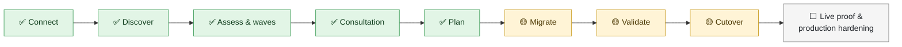
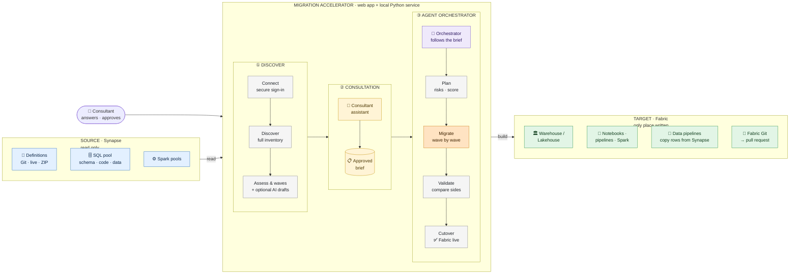
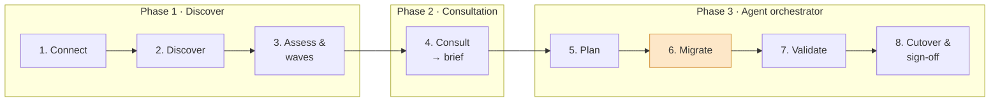
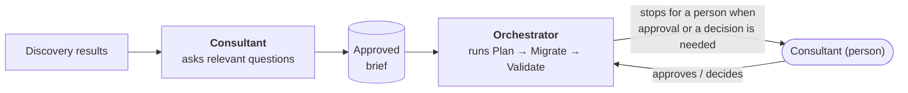

# Synapse to Fabric Migration Accelerator: Architecture Overview

This document starts with where Phase 1 stands today: the work done, the work remaining and the main blockers. It then explains how the Migration Accelerator works: its architecture, how a migration runs from start to finish, what it can migrate, and what comes next.

---

## Contents

1. [Phase 1 status: work done, work remaining and key blockers](#1-phase-1-status-work-done-work-remaining-and-key-blockers)
2. [Architecture at a glance](#2-architecture-at-a-glance)
3. [How a migration works, end to end](#3-how-a-migration-works-end-to-end)
4. [The two assistants](#4-the-two-assistants)
5. [Sign-in and permissions](#5-sign-in-and-permissions)
6. [What gets migrated](#6-what-gets-migrated)
7. [Roadmap](#7-roadmap)
8. [Readiness summary](#8-readiness-summary)

---

## 1. Phase 1 status: work done, work remaining and key blockers

**Phase 1** is the Azure Synapse → Microsoft Fabric accelerator, the only migration route enabled in the application today. (This is the project phase. It is separate from the three phases inside the application, which are described in sections 2 and 3.)

### Where we are

<small>✅ built and tested · 🟡 built, not yet proven on a live Fabric environment · ⬜ still to do</small>

### Work done

| Area | What is in place |
|---|---|
| **Connections** | Secure Microsoft sign-in to Synapse (all tenants of the account) and to Fabric (Azure CLI or Fabric CLI). Workspace and SQL pool picked from lists. Every link is checked, including the Fabric capacity. Definitions can be read from Git, the live workspace or a ZIP export. |
| **Discovery** | A full read-only inventory: SQL pool objects, security, data masks, row-level security, table sizes, query history, pipelines, notebooks, scripts, Spark pools and libraries, triggers and lake databases. Git and the published workspace are compared, and secret references are found without reading their values. |
| **Assessment** | Every object is mapped to its Fabric equivalent and classified. A dependency map is built and objects are grouped into waves. |
| **Consultation** | The Consultant assistant (about 70 questions, each asked only when relevant) produces a brief that a person approves. |
| **Orchestrator** | Carries out the approved brief from planning to sign-off, and stops for a person at every gate. |
| **Planning** | About 30 risk checks, a readiness score, effort estimates and a Fabric capacity estimate. A run cannot start while a blocking risk remains. |
| **Migration** | 11 stages: Warehouse or Lakehouse, schemas, tables, functions, views, procedures, security (roles, grants, masks, row-level filters), table data via Fabric data pipelines (with date filters and incremental sync), Spark environments, notebooks, connections, pipelines, Spark jobs, SQL scripts, schedules and storage shortcuts. Runs are safe to repeat, and *Retry failed* re-runs only what failed. |
| **Validation and cutover** | Structure, row counts, data profiles, view and procedure results, run checks, storage access checks and a performance comparison. Cutover covers the final sync, switching schedules on or off, and recording the approval. |
| **Around the run** | Commit to Fabric Git with a pull-request link. Optional AI drafting with a human review step. Demo mode. Background service. A downloadable CSV report. |
| **Quality** | 1,666 automated tests pass without Azure access. |

### Work remaining for Phase 1

| # | Work item | Why it matters | Priority |
|---|---|---|---|
| 1 | **Run one full migration on a real Synapse workspace and Fabric capacity** | Proves the data-load pipelines, incremental sync, Spark library upload, Environment attachment and cutover schedule switching. Until now these have been tested only offline. | Must have |
| 2 | **Keep run progress across restarts** | Today a service restart loses the run's record and the credentials typed for it. | Must have |
| 3 | **Working migration chat assistant** | The panel is visible in the app but not built. | Could have |
| 4 | **Deploy from Dev to Test and Prod** (`fabric-cicd`) | Completes the release path after the Dev migration. | Could have |

### Main complex blockers

These are the hardest problems in Phase 1. Each one comes from a real difference between Synapse and Fabric, not from a simple defect, so each needs design work rather than a quick fix.

| # | Blocker | Why it is hard | How we handle it now | What will resolve it |
|---|---|---|---|---|
| 1 | **Data movement cannot be proven offline** | Table data is moved by Fabric's own pipelines. Their behaviour (copy settings, staging, IDENTITY handling, sync transactions) can only be confirmed on a real Fabric capacity with real data. | Pilot wave first. Pipelines can be created without running, then checked in Fabric. Row counts and data profiles are compared after every load. | Work item 1, the live end-to-end run, kept as a regular test. |
| 2 | **Identity changes between Synapse and Fabric** | In Synapse, code reads storage and databases as the *workspace's managed identity*. In Fabric it runs as the *signed-in user*, or through a Fabric connection. Storage in another tenant rejects that user whatever roles they have. Synapse never releases the secrets behind its linked services. | Every storage location the code uses is listed. Access is routed through OneLake shortcuts with a connection that works. Connection credentials are chosen in Plan (workspace identity and Key Vault preferred). | Client agreement on the target identity model, plus more connection types supported. |
| 3 | **Converting procedural T-SQL for a Lakehouse** | A Lakehouse's SQL endpoint is read-only, so stored procedures that change data must become Spark notebooks. Transactions, cursors, temporary tables and error handling have no direct Spark equivalent. | The Warehouse is the recommended target. For a Lakehouse, unconverted statements are marked `# REVIEW`, and AI drafting helps with a human approving every draft. | Broader conversion rules and a test library of real procedures. |
| 4 | **Fabric features that do not exist** | Fabric has no SQL-login users, no multi-statement table functions, no row-level "block" rules, only `bigint` IDENTITY, and a collation that is fixed at creation. Some Synapse objects have no one-to-one target. | Each case is detected before the run and listed with the reason and the replacement to choose (for example the Entra user that replaces a SQL login). | Decisions agreed in Consultation, and a Fabric roadmap check before each client. |
| 5 | **Sizing Fabric capacity** | Microsoft publishes no conversion from Synapse performance levels (DWU) to Fabric capacity units, so any estimate rests on an assumption. | The estimate states its assumption and shows the evidence it used (pool size, Spark cores, data volume, peak concurrency). | Calibration from the pilot using the Fabric Capacity Metrics app. |

---

## 2. Architecture at a glance

The whole platform fits in one picture. **Read it left to right:** Synapse on the left is read, goes through the application's **three phases** in the middle, and is rebuilt in Fabric on the right.

<small>Blue = source (read only) · yellow = consultation · purple = orchestrator · orange = the only step that writes · green = Fabric target. Every step is confirmed by a person.</small>

### The story in five lines

1. **Phase 1, Discover.** The consultant connects both sides with a secure Microsoft sign-in. The accelerator then reads the whole Synapse estate without changing anything, maps every object to Fabric and puts the objects in dependency order.
2. **Phase 2, Consultation.** The **Consultant assistant** asks only the questions that matter for this estate, recommends an answer to each, and produces a **brief** that a person approves.
3. **Phase 3, Agent orchestrator.** The **Orchestrator** follows the approved brief: plan, migrate, validate, cutover. It pauses for a person whenever the brief, a risk or a mismatch calls for one.
4. **Fabric is built wave by wave** (the orange step). Table data is copied by Fabric's own pipelines, straight from Synapse, and never passes through the tool.
5. **The result is proven.** Both sides are compared, the cutover is signed off, and Fabric goes live.

### What each part does

| Part | In plain terms |
|---|---|
| **Consultant assistant** | A guided questionnaire that adapts to what discovery found. It recommends answers and turns the approved answers into the settings for the run. It follows fixed rules and does not use AI. |
| **Orchestrator** | Runs plan, migrate, validate and cutover in order, using the same buttons a person would. It stops and waits for a person at every approval point. It follows fixed rules and does not use AI. |
| **Web app** | What the consultant uses. It shows results, risks and progress for every phase. A **Demo mode** runs on sample data with no Azure access. |
| **Local service** | A small Python program on the same machine. It does all the real work and is the only part that talks to Azure and Fabric. It runs in the background as a Windows scheduled task. |
| **Secure sign-in** | Signs in to Synapse and Fabric with the consultant's own Microsoft account. Tokens are kept in memory only, and no secret is ever saved. |
| **AI drafting** | Optional. For code the built-in rules cannot convert, it asks Claude for a draft. **A person must review and accept every draft** before it is used. |
| **Fabric data pipelines** | The accelerator *builds* these pipelines, and Fabric runs them. **Table data goes straight from Synapse to Fabric.** |

### Design principles

1. **Synapse is never changed.** Every call to Synapse is a read.
2. **Only the Migrate step writes, and only to Fabric.**
3. **No secrets are stored.** Sign-in happens in Microsoft's own sign-in window. Credentials needed for the run are held in memory for that run only.
4. **Predictable results.** The same input gives the same result. AI is used only when a person asks for it, and only after that person approves the output.
5. **Honest reporting.** Anything that cannot be migrated automatically is listed with the reason, both before and after the run.

---

## 3. How a migration works, end to end

The migration runs in the application's **three phases**, made up of **eight stages**. Each stage must be reviewed and confirmed before the next one opens.

<small>Only stage 6 (highlighted) writes anything, and only to Fabric. In phase 3 the Orchestrator can run the stages for you, or you can run each one yourself.</small>

### Phase 1: Discover

#### Stage 1: Connect to Synapse and Fabric

**What happens.** The consultant signs in and chooses the source and target from drop-down lists. Nothing is typed by hand.

* **Synapse (source):** the consultant signs in with their Microsoft account, then picks the subscription, resource group, workspace and dedicated SQL pool. Object definitions (pipelines, notebooks and so on) can be read from one of three places:
  * the workspace's **Git repository** (recommended, and selected automatically when the workspace has one);
  * the **live workspace**;
  * an uploaded **ZIP export**.
* **Fabric (target):** the consultant signs in with the Azure CLI or the Fabric CLI and picks the Fabric workspace.

**Checks before moving on.** The tool tests each link: Azure access, the Synapse workspace, permission to read its definitions, the SQL pool, the Fabric workspace, and that the workspace has a **Fabric capacity**. *Start migration* stays disabled until every check passes, and a checklist shows what is missing.

**Result:** both sides are connected and verified.

#### Stage 2: Discover the Synapse estate

**What happens.** The tool reads everything, from up to three sources at once:

* **Definitions** of pipelines, datasets, linked services, notebooks, SQL scripts, Spark job definitions and triggers, from Git, the live workspace or the ZIP.
* **The SQL pool catalog**: tables, columns, views, procedures, functions, security roles and permissions, data masks, row-level security, table sizes and recent query history. It uses 22 fixed, read-only queries.
* **Workspace settings**: Spark pools, libraries, integration runtimes and lake databases.

What each source says about the same object is merged into one record. The tool also flags any difference between what is in Git and what is published. It records where secrets are *referenced* (for example Key Vault) but never reads secret values.

**Result:** a full inventory, which can be searched on screen and exported as JSON.

#### Stage 3: Assess and work out the order

**What happens.**

* **Classification.** Each object is put into one of five groups:
  * **Direct:** Fabric has an equivalent.
  * **Reconfigure:** the same idea, set up differently.
  * **Transform:** the code must change.
  * **Manual:** a person must do it.
  * **Review:** there is no clear equivalent.
* **Dependencies.** The tool builds a map of what depends on what. For example, a view depends on its tables, and a pipeline depends on its notebooks.
* **Waves.** Objects are grouped into numbered waves so that nothing is created before the things it needs. Wave 1 can serve as a pilot.

**Result:** every object has a Fabric target, a classification and a wave.

### Phase 2: Consultation

#### Stage 4: Consultation (the Consultant assistant)

**What happens.** The Consultant assistant asks the questions a consultant would agree with the client before migrating. Examples: Warehouse or Lakehouse? Which collation? How much data should be loaded? How strict should validation be? Who signs off the cutover?

* It asks only about features that discovery actually found. For example, there is no Spark question if there are no Spark notebooks.
* Each question comes with a recommendation and the reason for it.
* The answers form a **migration brief**, which a person submits and approves. The brief then sets the options for the run.

**Result:** an approved brief that drives the rest of the migration.

### Phase 3: Agent orchestrator

From here the **Orchestrator** can drive stages 5 to 8 by following the approved brief. It stops for a person at every approval point. Each stage can also be run by hand.

#### Stage 5: Plan

**What happens.** The planner reads the real definitions and runs about 30 checks. Each problem it finds is rated Blocking, High, Medium or Low. The plan then gets:

* a **strategy per object** (automated, manual, or assess first);
* an **effort estimate**;
* a **readiness score from 0 to 100**;
* a **capacity estimate**, meaning which Fabric capacity size (SKU) the workload is likely to need.

On the *Stages & credentials* screen the consultant chooses which stages run and supplies any connection credentials Synapse will not hand over. Those credentials are used once and never saved.

**Safety gate.** The plan cannot be confirmed, and the run cannot start, while any **Blocking** risk remains.

**Result:** an approved plan with no blocking risks.

#### Stage 6: Migrate

**What happens.** The tool creates objects in Fabric **wave by wave**. Within each wave it works in a fixed order: the Warehouse, then schemas, tables, functions, views, procedures, security, table data, Spark environments, notebooks, scripts, Spark jobs, pipelines, shortcuts and schedules.

* **Structure** is created with SQL statements and Fabric's REST API.
* **Table data** is loaded by Fabric data pipelines, one per wave, which the tool builds and starts. Row counts are compared when each load finishes.
* **Safe to repeat.** An object that already exists in Fabric is skipped, so the run can be repeated without creating duplicates. An option can update existing views, procedures, notebooks and pipelines instead of skipping them.
* **Controls:** pause, resume, *Retry failed* (re-runs only the objects that failed), and stop at the end of a wave if something failed.
* **Fabric Git.** When the Fabric workspace is connected to Git, the tool commits what it created to the `dev` branch and offers a pull-request link.

**Result:** objects in Fabric, each with a status of done, skipped, failed or left for a person, and a reason.

#### Stage 7: Validate

**What happens.** The tool reads both sides and marks each check as **Match**, **Review** or **Mismatch**:

* **Structure:** table columns and data types, views, procedures and security settings.
* **Data:** row counts and, optionally, a "data profile" for each table (totals, empty values, date ranges and duplicate keys), compared within an agreed tolerance.
* **Does it run in Fabric?** Tables and views are queried, and procedures are compiled. Pipelines and notebooks are judged by their last run, or run on request.
* **Access:** every storage shortcut is test-read.
* **Performance (optional):** recent heavy queries from Synapse are replayed in Fabric and the timings compared.

**Result:** a validation report showing what matches and what needs attention.

#### Stage 8: Cutover and report

**What happens.** The Cutover screen shows whether Fabric is ready to take over. That means there are no mismatches, synced tables are up to date, and the last sync succeeded. Three actions are available, and each one runs only when the consultant presses it:

1. Run a final data sync.
2. Switch the Fabric schedules on, or back off if a rollback is needed.
3. Record who approved the cutover.

A **CSV report** of every object and every check can be downloaded.

**Result:** go-live decision recorded, plus the final report.

---

## 4. The two assistants

The application includes two assistants. Both follow **fixed rules**. Neither one uses AI.

| Assistant | What it does |
|---|---|
| **Consultant** | Chooses questions from a catalogue of about 70, based on what discovery found. It recommends an answer to each, and turns the approved answers into run settings. |
| **Orchestrator** | Carries out the approved brief in nine stages. It uses exactly the same buttons and actions a person would, so it has no hidden powers. It **stops and waits for a person** when the brief asks for approval, when a blocking risk appears, or when validation finds mismatches. |

The only AI in the product is the optional **AI drafting** described in section 2. A *migration chat assistant* panel is visible in the app, but it is a preview and not yet working.

---

## 5. Sign-in and permissions

| Side | How it signs in | Permissions needed |
|---|---|---|
| **Synapse** | A Microsoft sign-in window opens and the consultant signs in. Every directory (tenant) the account belongs to is searched. | **Reader** on the resource group. A Synapse role such as **Synapse Artifact User** to read definitions. A database user that can read the SQL catalog (plus **VIEW DATABASE STATE** for sizes and query history). |
| **Fabric** | The **Azure CLI** (`az login`) or the **Fabric CLI** (`fab auth login`) | **Contributor** (or higher) on a Fabric workspace that has a capacity. Permission to create connections. |
| **Data load** | A Fabric connection to the Synapse pool, chosen in Plan. **Workspace identity** or a **Key Vault reference** is recommended, so no secret passes through the tool. | The connection must be able to reach the Synapse pool through its firewall. |

Fabric uses three kinds of access: its REST API, the Warehouse SQL endpoint, and OneLake storage. Each needs its own sign-in token. The tool requests and renews these automatically. Tokens are kept in memory only and never written to disk or logs.

---

## 6. What gets migrated

**Key:** **Automated** = done by the run. **Partly** = automated with limits, or not yet proven on a live Fabric environment. **Manual** = listed for a person, with the reason.

| Synapse object | Becomes in Fabric | Status |
|---|---|---|
| Dedicated SQL pool | Warehouse (or Lakehouse) | Automated |
| Schemas, tables | Schemas, tables with data types mapped (created empty, then loaded) | Automated |
| Views, functions, stored procedures | The same, after automatic T-SQL rewrites | Automated (unusual T-SQL needs a person or an AI draft) |
| Roles, permissions, data masks | The same in the Warehouse | Automated |
| Row-level security | Security policy (filter rules only) | Partly. "Block" rules are manual. |
| SQL-login users | — | Manual. Fabric only supports Microsoft Entra accounts. |
| **Table data** | Loaded by generated Fabric data pipelines, with optional date filters and ongoing sync | **Partly. Not yet proven on a live Fabric run.** |
| Notebooks | Fabric notebooks, with Synapse-specific code updated | Automated |
| Spark pools | Fabric Spark pool and Environment, with libraries | Partly. Uploaded package files are manual. |
| Spark job definitions, SQL scripts | Fabric Spark jobs, SQL notebooks | Automated |
| Linked services | Fabric connections | Partly. SQL, Data Lake and Blob only. Other types are manual. |
| Pipelines and datasets | Fabric data pipelines | Partly. Pipelines with data flows are manual. |
| Schedule triggers | Pipeline schedules, created switched **off** | Partly. Event and tumbling-window triggers are manual. |
| External tables | OneLake shortcuts | Partly. Data Lake and Blob storage only. |
| Integration runtimes, lake databases, serverless SQL, networking | — | Manual |

**About the Lakehouse option.** A Lakehouse can be chosen instead of a Warehouse. It is the newest part of the tool. Stored procedures are converted to Spark notebooks, and many of them will need review. The Warehouse is the recommended target today.

---

## 7. Roadmap

**Priority 1: needed for production**

* **One full live test** on a real Synapse workspace and Fabric capacity, to prove data loading, sync and cutover.
* **Save run progress** so that a restart does not lose it.
* **Automatic retries** for temporary Fabric errors.
* **Better ordering** of dependent objects within a wave.
* **Stronger data checks**, such as row-level checksums for large tables and detection of deleted rows.

**Priority 2: important improvements**

* A smarter Consultant, with follow-up questions based on what was found.
* Recommendations on target (Warehouse or Lakehouse) and phasing for each workload.
* Support for more connection types (REST, Oracle, Snowflake, on-premises through a gateway).
* Live progress for data loads, and a detailed downloadable report (HTML or PDF).
* A working chat assistant that explains failures and suggests fixes.

**Priority 3: future direction**

* More sources and targets (Azure Data Factory, SQL Server, Databricks, Snowflake). These already appear in the app as *Coming soon*.
* Reusable migration "adapters", so new platforms can be added more easily.
* Background agents per workstream, driven by the approved brief, with human approval gates kept.
* Automatic fixing of common T-SQL incompatibilities.
* Phased, near-zero-downtime cutover.
* An audit trail and monitoring.
* Automated deployment from Dev to Test and Prod.

---

## 8. Readiness summary

| Area | Readiness |
|---|---|
| Connecting, discovery and assessment | **Ready.** Read-only and well tested. |
| Consultation and planning | **Ready for consultant-led use.** The scores are estimates. |
| Migrating structure and code to a Warehouse | **Ready for a pilot.** It is safe to re-run, and the manual items are clearly listed. |
| Table data loading, sync and cutover | **Not yet production-ready.** It needs one successful live test. |
| Running the tool | **Single-user, runs on one machine.** There are no shared projects and no audit trail yet. |

**Overall:** the accelerator is well designed and safety-first. It never changes Synapse, stores no secrets, and lets people approve every important step. It is ready for a **pilot migration**. The main step before production use is **one complete live test**, followed by saving run progress so that a restart does not lose it.
